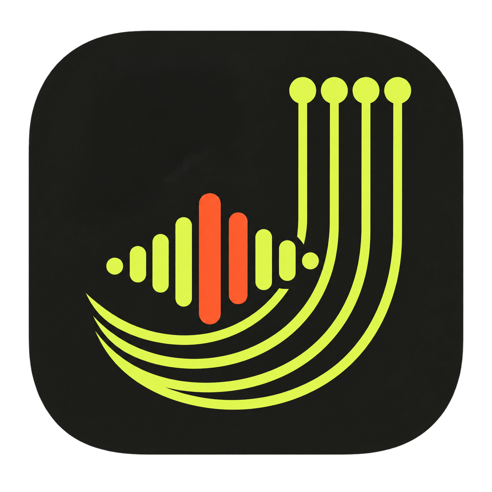

# jmusic PoC

完全本地的 Tauri 2 音频转尤克里里和弦与旋律 TAB 实验。

## 验证范围

- 从本地载入 MP3、WAV、M4A 或 FLAC。
- 在 WebView 内用 Spotify Basic Pitch TensorFlow.js 模型识别音符。
- 从复音音符聚合大三、小三、7、maj7、m7、sus2、sus4 和 dim 和弦时间轴。
- 为检测到的和弦生成可弹的 High-G / Low-G 四弦品位，并与播放器联动。
- 将模型输出约简为单旋律，并映射到 High-G 或 Low-G 尤克里里弦与品位。
- 音频播放位置与生成的 TAB 联动。
- 播放时可一键静音；静音只影响监听，不影响本地分析结果。

和弦与 TAB 都是自动草稿。复杂混音、转调和完整指弹编配通常仍需要分轨、节拍分析和人工校正。

## 运行

```bash
pnpm install
pnpm test
pnpm tauri dev
```

## 本地资源与许可

- `public/model/` 来自 `@spotify/basic-pitch@1.0.1`，Apache-2.0。
- `public/samples/c-major.mp3` 来自 Spotify `basic-pitch-ts` 官方测试素材，随 PoC 打包用于离线演示。
- C · Am · F · G 和弦测试音频由 App 在本机即时合成，不含第三方音乐素材。
- App 运行时不会请求云端转录服务，也不会上传音频。

## License

[MIT](LICENSE) © 2026 cnjack. Bundled third-party components retain their
respective licenses; see [THIRD_PARTY_NOTICES.md](THIRD_PARTY_NOTICES.md).
